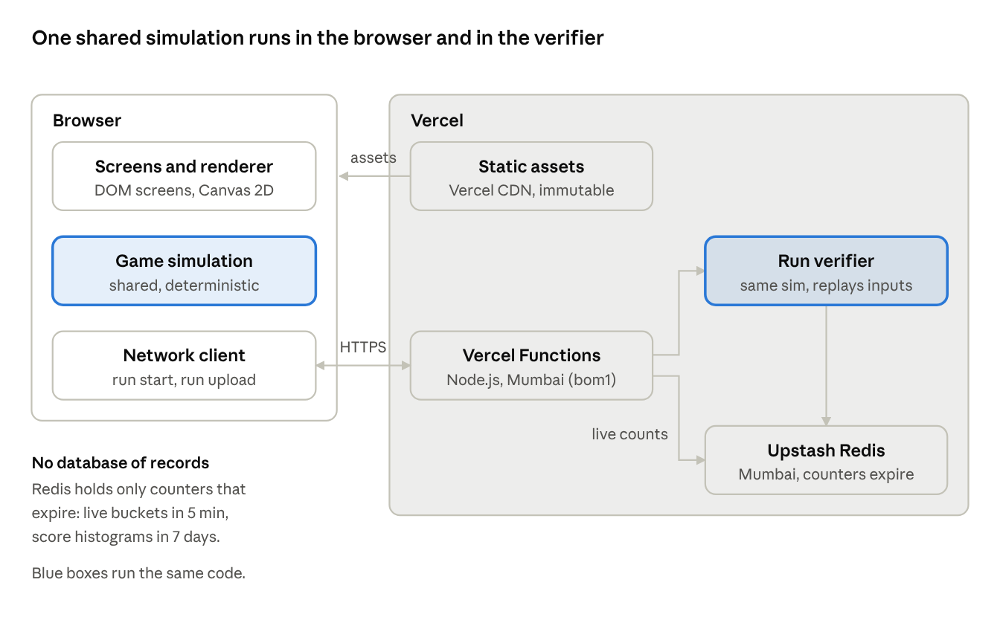

# Architecture review and plan

Oct 15, 2026 · Kirti · Live doc: https://claude.ai/code/artifact/4b6e4c1d-7c5d-4a55-8daf-07749538da3a (Architecture tab) · PRD: [prd.md](prd.md)

## Verdict

The PRD is buildable on Vercel as a static site plus three small Vercel Functions. Functions keep no memory between requests, so live counts and percentiles need one shared store. Upstash Redis is the minimum: expiring counters only, no records and no database of players. Five things must change before code starts:

1. **Make the simulation deterministic and shared.** One TypeScript package runs the game in the browser and re-runs it in a Vercel Function. That is the only honest way to compute "72% of today's Agency" without trusting the client.
2. **Define a world coordinate space and a tick clock.** "24 px" and "0.8 s" must mean the same thing on every phone. Use 360 x 780 world units and a fixed 60 Hz tick.
3. **The 400-roach cap is a simulation rule, not a drawing rule.** It bounds CPU on the phone and in the Function.
4. **Share links carry the side only, never the score.** Otherwise anyone can forge a "held till 9 PM" link.
5. **No device or session id.** Live counts come from run starts, so there is no id, cookie or consent banner.

With these, the only stored data is anonymous counters that expire within 7 days. Everything else lives in the browser or Vercel's CDN cache.

## PRD review

Ordered by how much each one would cost to fix after launch. All twelve changes are now written into the PRD's rules; server-only details (row 11) stay here.

| # | PRD says | Problem | Change |
| --- | --- | --- | --- |
| 1 | Percentile "You held longer than 72%" | A client-reported score can be faked with one curl call, and it poisons everyone's percentile | Client uploads its input log; a Function re-runs the shared sim and scores it |
| 2 | Distances in px, times in s | Phones differ in size and frame rate, so hit radius and timing would differ per device. The server can't replay pixels | All rules in world units (360 x 780 field) and ticks (60 per second). Rate limit 8/s becomes one smash per 8 ticks per pointer |
| 3 | "Max 400 sprites on screen" | As a render cap the sim still grows without bound: slow phones, slow and costly replays | Cap active roaches at 400 inside the sim; the rest is an integer queue at the metro |
| 4 | "Densest cluster" (Prime Time, Agency AI) | Undefined, so client and server could pick different spots | Split the field into 40 x 40 cells; pick the cell with most roaches; ties go to the lowest cell index |
| 5 | "30% more roaches" on Prime Time backfire | Fractions are ambiguous | floor(frozen x 3 / 10), spread round-robin over the six roads |
| 6 | Share link "opens on the same side" with the score | Score in the URL lets anyone fake a brag | URL carries `?side=` only. The brag lives in the image and message text |
| 7 | "Random device id" | A persistent id is personal data under India's DPDP Act and needs notice | No id at all (see row 8) |
| 8 | Live count "until 60 s after last input" | Heartbeats mean a Function call per player every few seconds: about 1,700 calls a second at 50,000 players | Count run starts instead: one call per run. **Applied to the PRD** |
| 9 | Daily edition "resets at midnight IST" | Phone clocks are wrong; runs straddle midnight | Seed = hash of the IST date, computed on the client. The server accepts today, or yesterday within 15 minutes of midnight |
| 10 | First load under 2 MB, Google Fonts | Slower on Indian 4G, and a third-party request weakens the security policy | Under 1 MB to first tap; self-host subset fonts |
| 11 | Sim tuning "in one config file" | A tuning change after launch breaks replay of runs in flight | Every upload carries `SIM_VERSION`. A Function scores only its own version and answers 409 otherwise; the client then shows its local score, marked unverified (Hobby plan has no Skew Protection) |
| 12 | Not covered | Reduced motion, haptics, offline, failed share, lost network, Redis down | Respect `prefers-reduced-motion`; vibrate on smash (Android, toggle); runs play offline but skip the percentile; share falls back to download plus copied text; if Redis is down, hide the ticker and show the score without a percentile |

## System design

The game is a static site on Vercel. The browser runs the whole game; Vercel Functions only count run starts and check finished runs.



The browser never talks to Redis. Every API call goes through a Vercel Function, which owns validation and rate limits; the Redis token exists only in server environment variables.

## Client architecture

**Stack: TypeScript (strict), Vite, Canvas 2D, no game engine, no UI framework.** Phaser is about 1 MB for features we don't use. Five DOM screens don't need React. 400 sprites drawn from one atlas fit well inside a frame on Canvas 2D. The renderer sits behind an interface, so PixiJS (WebGL) can replace it if profiling on low-end phones says so.

**Repo: one pnpm workspace, one Vercel project, dependencies point one way.**

```
packages/sim        pure game rules; no DOM, no Date, no Math.random, zero dependencies
apps/game           the Vercel project's root directory
  src/              browser app; imports sim
  api/              Vercel Functions, one thin file per route; imports server
  server/           server-only code; imports sim, never imported by src
  vercel.json       headers, function region, caching
```

```
packages/sim/src
  config.ts         every tuning number in the PRD, plus SIM_VERSION
  rng.ts            seeded PRNG (sfc32), seed = hash("suc:" + IST date)
  fixed.ts          integer fixed-point maths (1/256 world unit)
  map.ts            lanes, canals, bridges, camera zones, the precomputed flow field to the arch
  state.ts          roaches as typed arrays (structure of arrays)
  input.ts          Tap, SitIn, Power, Listen, Answer, Steer, SteerEnd; each stamped with a tick
  systems/          clock, spawn, move, barricade, hydra, sympathy, powers, lathis, agencyAi, arch,
                    and moments (the cockroach side's scheduler and judge)
  step.ts           one tick: apply inputs, then systems in a fixed order
  result.ts         end conditions and score
  replay.ts         encode/decode input log (varint binary)

packages/sim/balance
  bots.ts           scripted strategies per side (idle, spam, restraint, powers, lead, Sit-in)
  run.ts            plays a bot over daily editions and reports p25 / median / p75
                    (`pnpm balance`; a 3-edition ordering check runs in CI)

apps/game/src
  main.ts           boot, router
  screens/          front, roster, play, result, howto  (one module each)
  render/           atlas, canvas renderer, interpolation, effects, captions
  input/            pointer to world units, keyboard
  audio/            Web Audio, one sprite file
  net/              typed API client
  share/            card renderer (OffscreenCanvas), Web Share with fallback
  content/          captions, strings, character roster and moment cards (tells,
                    headlines, placards, gags) as data

apps/game/api
  run-start.ts      POST /api/run-start
  live.ts           GET  /api/live
  runs.ts           POST /api/runs

apps/game/server
  env.ts            reads and validates server env vars once; fails fast
  redis.ts          Upstash client over HTTPS (REST), one instance
  live.ts           run-start buckets and totals
  histogram.ts      percentile buckets per edition and side
  verify.ts         decode log, replay with sim, score
  limits.ts         rate limits
  http.ts           origin check, body cap, typed responses, error mapping
```

**Determinism rules (enforced by lint in `packages/sim`).**

- Integer maths only. No floats in state; `Math.sin`, `Math.sqrt` and friends are banned because results can differ between Safari and Chrome.
- No `Date`, `Math.random` or `performance.now`. Every `sort` takes a total comparator (ties broken by roach id).
- Inputs are applied at the start of the tick they're stamped with, before any system runs. This settles PRD edge cases like "Sit-in vs a landing stamp".

**Cockroach moments.** The cockroach side is a run of one-tap moments (see the PRD). They follow the same rules as everything else in the sim, so runs stay replayable and verifiable:
- **Scheduling is in the sim.** `systems/moments.ts` opens a moment when one is due and none is open, picks its kind for the phase of the evening, and closes it when its window ends or it is answered. Kind, cards and the fake protester's tell come from a second random stream seeded only by the edition, so every player that day sees the same moments whatever they do.
- **Content is data, not logic.** The sim picks card indexes; `apps/game/src/content/moments.ts` holds the words. The card counts live in `config.ts`, and a test fails if the content and the counts disagree.
- **Answers are inputs.** `Answer` carries the chosen option, and a `Tap` on the cockroach side accuses a roach (the client sends a Tap instead of a Steer while a fake moment is open). The sim judges them, then emits `MomentOpen`, `MomentResult` and `Surge` events.
- **Rewards are sim state.** A surge is a timer (`timers.surgeUntil`) that `pace.ts` reads to make the whole swarm chant at 1.5x. Bystanders who join are ordinary spawns. The fake protester is an ordinary roach with a `role` column, so stamps, the cap and the hash treat him like everyone else.
- **The client only presents.** `play/moments/` draws the cards and the ticker over the canvas, and `render/` draws the tells and the "SUS!" stamp. Nothing on screen decides an outcome.

**Game loop.** Fixed 60 Hz sim with an accumulator, capped at 5 steps per frame so a slow frame can't spiral. Rendering runs on `requestAnimationFrame` and interpolates between the last two states. Pause stops the accumulator; the replay doesn't see wall time.

**No allocation in the loop.** Typed arrays and object pools for roaches, stamps and particles. The aim is zero garbage-collection pauses during a run.

**DOM safety.** Screens build elements with `createElement` and `textContent` only. `innerHTML` is banned by lint and blocked at runtime by Trusted Types.

## Backend

**Three Vercel Functions on the Node.js runtime in Mumbai (bom1), and one Upstash Redis database in Mumbai.** Functions forget everything between requests, so a number shared across players has to live somewhere. Redis is used only as expiring counters: no tables, no records about people, nothing that needs a backup. Fluid compute stays on (the default), which reuses warm instances and keeps cold starts rare.

| Route | Request | Response | Notes |
| --- | --- | --- | --- |
| `POST /api/run-start` | `{edition, side}` when a run begins | 204 | One `INCR` on the current 10-second bucket for that side; the bucket expires after 5 minutes |
| `GET /api/live` | none | `{roaches, agencies}` | Sums the last 24 buckets with one `MGET`. `Cache-Control: s-maxage=10, stale-while-revalidate=30`, so Vercel's CDN answers almost every request |
| `POST /api/runs` | Binary: version, edition, side, character, run id, input log | `{score, percentile}` | 32 KB cap. Replayed by the shared sim; the client's own score is ignored |

**State, and where it lives.**

| Data | Key and type | Expires |
| --- | --- | --- |
| Run starts per side | `live:{side}:{slot}` counter, one per 10 s | 5 minutes |
| Score histogram per edition and side (211 time buckets for Agency, 64 log buckets for Reached) | `hist:{edition}:{side}` hash, `HINCRBY` | 7 days |
| Run ids already scored | `run:{id}`, `SET NX` | 10 minutes |
| Rate-limit windows | `rl:{route}:{hash}`; the hash is of the IP with a salt that rotates daily | 60 seconds |
| Percentile snapshot | Function instance memory | 10 seconds |

Nothing else is stored: no IPs, no accounts, no input logs. A relational database is added only if a later feature needs per-player history, such as named leaderboards.

**Run verification flow.** Check origin, size and header; check `SIM_VERSION` and the edition window; reject a run id already seen; decode the log; replay at most 12,600 ticks; score it; `HINCRBY` the histogram; answer with the percentile from the instance's snapshot (refreshed with one `HGETALL` when older than 10 s). Replay should take 30 to 80 ms of CPU. Measure it in milestone 12 and set the function's `maxDuration` to 10 s as a hard stop.

**Failure modes.** Redis unreachable: `/api/live` returns 503 and the ticker hides; `/api/runs` returns the verified score with `percentile: null`. Function error: the result page still shows the local score, labelled unverified. The game itself never waits on the network.

## Security and abuse

A politically charged, viral game will be attacked for fun and for spite. There is no login and almost no stored data, so the main targets are the live counter, the percentiles, the page itself and availability.

| Threat | Control |
| --- | --- |
| Fake scores skewing percentiles | Server-side replay (above). Bots that play well are accepted; they can only shift an anonymous histogram |
| Bots inflating one side's live count | Vercel WAF rate-limit rule on `/api/run-start`, plus a per-IP-hash limit in code. Limits stay generous (60 a minute) because Indian mobile carriers put many players behind one IP (CGNAT). Residual risk accepted: the count is entertainment |
| Script injection or defacement through the page | Strict CSP (below), Trusted Types, no `innerHTML`, no third-party scripts, URL parameters parsed against an allowlist (`side` only) |
| Malformed or huge run uploads | 32 KB body cap, header check before decode, tick and event caps in the decoder, `maxDuration` 10 s |
| Replay of the same run | Run id deduped for 10 minutes |
| Cross-site requests to the API | Same-origin only: no CORS headers, `Origin` checked on POST, `Content-Type` fixed |
| DDoS | Vercel's built-in DDoS mitigation; static files and `/api/live` served from the CDN cache; WAF rules; Attack Challenge Mode ready to switch on |
| Leaked Redis token | Token in server env vars only, never with a `VITE_` prefix (Vite ships those to the browser). CI fails if the token pattern appears in the client bundle. Separate Redis databases and tokens for Preview and Production |
| Supply-chain compromise | Client runtime dependencies: target 0. Server: `@upstash/redis` and `valibot` only. Lockfile frozen in CI; Renovate with a 7-day delay; GitHub Actions pinned by commit SHA |
| Preview deployments exposed | Vercel Deployment Protection on previews |
| Clickjacking or framing the game on a fake site | `frame-ancestors 'none'` |
| Runaway bill from a traffic spike or attack | Hobby plan hard usage limits on Vercel (no overage billing); monthly budget cap on each Upstash database |
| Takedown pressure on the caricatures | Characters live in `content/` behind a build flag; a faceless roster ships in one redeploy |

**Response headers, set in `vercel.json` for all routes.** Turn the Vercel Toolbar off on previews; it injects a script this policy would block.

```
Content-Security-Policy: default-src 'none'; script-src 'self'; style-src 'self';
  img-src 'self' data: blob:; font-src 'self'; connect-src 'self'; media-src 'self';
  manifest-src 'self'; worker-src 'self'; base-uri 'none'; form-action 'none';
  frame-ancestors 'none'; require-trusted-types-for 'script'
Strict-Transport-Security: max-age=63072000; includeSubDomains; preload
X-Content-Type-Options: nosniff
Referrer-Policy: strict-origin-when-cross-origin
Permissions-Policy: camera=(), microphone=(), geolocation=(), payment=()
Cross-Origin-Opener-Policy: same-origin
```

**Privacy.** No cookies, no ids, no stored IPs (rate limits use a daily-salted hash that expires in 60 s). Vercel Web Analytics is cookie-less and served from our own domain, so the CSP stays `'self'` only. On the Hobby plan it records page views only; custom game events wait for Pro. A one-page privacy note states this.

## Performance budget

Reference device: a 4 GB Android phone from 2022 (Redmi or Moto G class) on 4G. CI fails a build that breaks a budget.

| Budget | Target | How |
| --- | --- | --- |
| JS, front page | 30 KB gzip | Screens only; play code loaded on "Pick a side" tap, prefetched while idle |
| JS, play | 60 KB gzip total | No engine, no framework, sim under 15 KB |
| Bytes to first tap | under 1 MB | Front-page art as AVIF/WebP at 2x; fonts subset to used glyphs, woff2, about 120 KB total |
| Play assets | under 600 KB | One sprite atlas (WebP), one map image, one audio sprite (AAC) |
| Largest Contentful Paint | under 2.0 s | Static HTML for the front page, one small stylesheet (no inline CSS, so the CSP needs no exceptions), fonts preloaded |
| Frame time | under 8 ms (sim 2 ms + render 6 ms) at 400 roaches | Typed arrays, spatial grid for hits and crowding, map drawn once to an offscreen canvas |
| GC pauses during a run | none over 4 ms | No allocation in the loop |
| Network during a run | 1 run-start call; 1 upload under 20 KB at the end | Input log as varints, then gzip via `CompressionStream` |
| Repeat visit | plays offline | Service worker precaches the hashed assets; `index.html` revalidated |

Caching (set in `vercel.json`): hashed files `public, max-age=31536000, immutable`; HTML `no-cache`; `/api/live` `s-maxage=10, stale-while-revalidate=30`; `/api/run-start` and `/api/runs` `no-store`.

## Code quality, testing and delivery

**Standards.**

- TypeScript `strict` plus `noUncheckedIndexedAccess` and `exactOptionalPropertyTypes`.
- ESLint (typescript-eslint strict) and Prettier, run in CI and pre-commit.
- `dependency-cruiser` enforces the one-way imports: `sim` imports nothing; `src` (browser) never imports `server` or `api`.
- Named exports only; one concept per module; no file over 300 lines without a reason in review.
- Every tuning number lives in `sim/config.ts`. No magic numbers in systems.
- Wire formats (run start, run log, responses) defined once in `sim/replay.ts` and a shared `api.ts`, validated in the Functions with Valibot.

**Tests.**

| Layer | Tool | What it proves |
| --- | --- | --- |
| Sim unit | Vitest | Each system against the PRD rules: Hydra 1 to 3, the climb threshold, Sympathy decay, the metro reserve, every boundary-condition row |
| Balance | Vitest + `pnpm balance` | Smashing everything falls before doing nothing, which falls before restraint; the full table checks the PRD tuning targets |
| Sim invariants | fast-check | Swarm never negative, Became never falls, Control never rises, active roaches never above 400 |
| Determinism | Golden replays in Playwright on Chromium, WebKit and Firefox | The same input log gives the same state hash on every engine and in the Vercel Function |
| API | Vitest, local Redis behind Upstash's REST proxy (SRH) in Docker | Routes, Redis keys and expiry, rejection of bad payloads (fuzzed) |
| End to end | Playwright, iPhone and Pixel viewports | Land, pick a side, play a scripted run, see the result, share fallback |
| Budgets | size-limit, Lighthouse CI | Bundle sizes and LCP from the table above |
| Load | k6 | 50,000 simulated players: run start and run upload hold p99 under 200 ms |

**Delivery.** GitHub Actions on each pull request: lint (ESLint, Prettier, dependency-cruiser, knip for dead code), typecheck, tests, build, budgets, bundle secret scan. Vercel's Git integration builds a protected preview per pull request, wired to the Preview Redis database. Merges to `main` deploy to Production. Without Skew Protection (Hobby), the service worker precaches every hashed asset so an open tab keeps working across a deploy, and `/api/runs` rejects a mismatched `SIM_VERSION`. Instant Rollback is the undo. Secrets live in Vercel environment variables scoped to Production or Preview; the client has none.

## Build plan

Each milestone ends deployed to a protected preview with CI green. Nothing is skipped to reach the next one.

0. **Docs and repo.** These decisions written into both documents; git repository pushed to GitHub.
1. **Foundation.** Workspace, lint, dependency rules, CI, `vercel.json` headers, empty page deployed to a protected preview.
2. **Sim core, Agency side.** Map, spawn, movement, Hydra, Sympathy, arch, clock, results. Headless, with unit and invariant tests and the replay format.
3. **Playable greybox.** Canvas renderer, pointer input, fixed-step loop, Agency play screen with placeholder art. First feel test on a real low-end phone.
4. **Cockroach side.** Sit-in, Agency AI stamps and barricades. Drag steering on flow fields, with occasional moments on top (see Cockroach moments).
5. **Powers.** Prime Time, Chanakya, Pradhan Sevak, with their backfires and the Actually Listen hold.
6. **Screens and content.** Front page, roster, result, how to play, captions, audio, reduced motion, haptics.
7. **Art and performance.** Atlas pipeline, final art, budget pass on the reference phone.
8. **Live counts.** Upstash databases (Preview, Production), `/api/run-start`, `/api/live`, CDN caching, ticker; hidden when the API is down.
9. **Share.** Card renderer, Web Share with files, fallbacks, static Open Graph image.
10. **Hardening.** Load test, fuzzing, header and CSP audit, WAF rules available on Hobby, privacy note, faceless-roster switch tested.
11. **Tune and launch.** Playtests to set the Reached quota and the 9 PM difficulty, then release on situationundercontrol.in.
12. **Verified percentiles (launch + 1 week).** `/api/runs`, replay in the Function, histograms, cross-engine determinism suite, CPU measured on Vercel.

**Decisions taken (Oct 16, 2026):**

- **Vercel plan: Hobby.** No Skew Protection (handled by the version check and service worker above), no Spend Management (Hobby has hard limits instead), page-view analytics only. The game has no ads or payments, which keeps it within Hobby's non-commercial terms.
- **Domain: situationundercontrol.in.**
- **Verified percentiles: a week after launch** (milestone 12). The sim and replay format are built deterministic from milestone 2, so nothing is reworked.
- **Repository:** github.com/kirti07/situationundercontrol.

## Sources

- [Vercel Skew Protection](https://vercel.com/docs/skew-protection) (Pro and Enterprise)
- [Redis on Vercel](https://vercel.com/docs/redis) (Vercel KV retired; Upstash through the Marketplace)
- [Vercel regions](https://vercel.com/docs/regions) (bom1, Mumbai)
- [Vercel Functions limits](https://vercel.com/docs/functions/limitations)
- [Vercel WAF rate limiting](https://vercel.com/docs/security/vercel-waf/rate-limiting)
- [Web Analytics custom events](https://vercel.com/changelog/custom-events-now-available-for-web-analytics)
