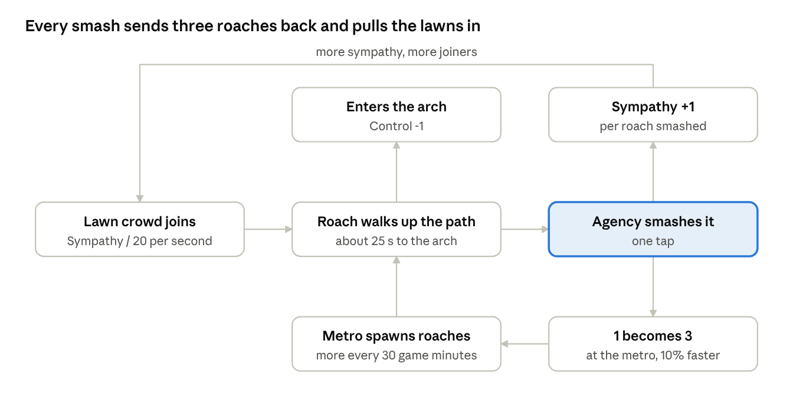

# Situation Under Control — Game PRD

Oct 15, 2026 · Kirti · Live doc: https://claude.ai/code/artifact/4b6e4c1d-7c5d-4a55-8daf-07749538da3a

## Overview

**Situation Under Control** is a one-thumb, 3.5-minute browser arcade game at India Gate, where every cockroach you smash becomes three more. The name is also the domain (situationundercontrol.in) and the Agency's game-over headline. It ships on Vercel, portrait-first, playable on mobile and desktop with no install or login.

- **The joke is the rule.** Force backfires visibly: smash 1, get 3. The Agency cannot win by smashing, and the game never says so. Players find out.
- **Two sides, one map.** Join the Agency (tap to smash) or Be the Cockroaches (drag to lead the swarm, and answer the odd moment: a fake protester, a placard duel). Both play the same 5:30 PM to 9:00 PM evening on Kartavya Path.
- **Why it spreads.** A live counter of both sides, a daily edition everyone plays with the same seed, a front-page result card built for WhatsApp, and a hidden ending people tell each other about.
- **Tone.** R.K. Laxman ink on newsprint for front pages; India Gate at night for play. Punch up, never down: no blood, no victims on screen, smashed roaches only split.

Source material: the two 15 Oct concept chats and the design board and screens in `design/exports`. Where they conflict, this PRD picks the simpler option.

## Core loop and controls

Each side has exactly one gesture and one button. Everything else is automatic.

|  | Agency | Cockroaches |
| --- | --- | --- |
| Goal | Keep roaches out of the arch as long as possible | Get as many roaches through the arch as possible by 9 PM |
| Gesture | **Tap** a roach to smash it | **Hold and drag**: roaches within 120 of your finger follow it at full pace, and those within 80 chant at 1.5x. Roaches that pass the finger carry on to the arch. Let go, or leave roaches behind for 2.5 s, and they dawdle at two-sevenths of the pace. Every 30 s or so a moment pops up: **tap** to answer it |
| Lathis | **6 lathis**; every tap spends one, hit or miss, and one comes back every ⅓ s | none |
| Button | **Power** (one per character, recharges) | **Sit-in** (recharges) |
| Secret | **Actually Listen** (always there, never explained) | none |
| Desktop | Click to smash, Space = Power | Hold mouse and drag; click or keys 1 to 3 to answer a moment; Space = Sit-in |
| Both | P or Esc = pause | P or Esc = pause |

**The Hydra rule (both sides):** a smashed roach is replaced by 3 roaches that respawn at the metro end of Kartavya Path, each 10% faster than its parent. Smashing buys the Agency time now and costs it later. For the cockroaches, getting smashed loses ground but grows the swarm.

**The Sympathy rule (both sides):** every smash raises Public Sympathy. Sympathy brings lawn crowds into the march as new roaches. The Agency's real skill is restraint: smash only roaches close to the arch.

A smash removes one roach near the arch but feeds both sources upstream, so the swarm always grows faster than it is cleared.

A run is one evening: the clock goes from 5:30 PM to 9:00 PM, one game minute per real second (210 s).

**Units.** Every distance in this PRD is in world units on a fixed 360 x 780 field, and every time runs on a fixed clock of 60 ticks per second. The game scales the field to the screen, so a rule behaves the same on every phone and the server can replay a run exactly. "24 px" below means 24 world units; "0.8 s" means 48 ticks.

## Map and entities

One fixed top-down map of Kartavya Path at night, India Gate at the top, the metro at the bottom. No scrolling.

| Element | Where | Behaviour |
| --- | --- | --- |
| Metro | Bottom edge | Where roaches spawn and where smashed children respawn |
| Three lanes | Centre path + left and right lawns | Roaches walk up any lane |
| Canals | Between lanes | Impassable. One bridge each, plus the metro concourse at the bottom, are the only crossings (choke points) |
| Lawns | Left and right lanes | Picnic crowd. Joins the march as roaches at a rate set by Sympathy. The lawns and the metro concourse are "on camera" (marked on the Agency map): a smash there earns 3x Sympathy and shows "ON CAMERA" |
| C-Hexagon roads | Six roads round the arch | Inactive until 7:00 PM, then spawn roaches close to the arch |
| The arch | Top | Goal. A roach that enters is removed and counted |
| Pigeon | On top of the arch | Never acts. Its caption changes with the score |

**Roach.** Walks up its lane at base speed (crosses the map in about 25 s). Each Hydra generation is 10% faster, capped at 2x base. Hit radius 24 px.

**Barricade.** Blocks one lane. Roaches pile up behind it; at 15 piled, they climb over together at 2x speed and the barricade stays (Masterstroke barricades come down after 15 s).

**Agency characters** (picked before the run; gameplay is otherwise identical). Power charges for 25 s, unlocks at 6:00 PM.

| Character | Power | Effect | Backfire |
| --- | --- | --- | --- |
| Prime Time | The Nation Demands | Freezes every roach within 120 px of the densest cluster (defined under Boundary conditions) for 8 s | When the freeze ends, 30% of the frozen count (rounded down) spawn, spread evenly over the six roads |
| Chanakya | Masterstroke | Drops a barricade across all three lanes for 15 s; when they come down, every pile walks on | Barricades obey the climb rule, so piles pour over at 2x |
| Pradhan Sevak | Mann Ki Baat | Sympathy drops to 0 and lawns stop joining for 20 s | You can't smash for the first 4 s of the speech. Roaches keep walking |

**Decision:** the three caricatures ship at launch as drawn on the board. They are named only by office, never by person, and the duty roster carries the line "All characters are satirical caricatures of public offices."

**Sit-in (cockroaches).** For 2 s the swarm stops and can't be stamped; Sympathy +25%. Charges for 15 s. On the cockroach side, Sit-ins are the only source of Sympathy: Agency stamps split roaches but win no sympathy.

**Agency AI (cockroach mode).** Drops a stamp on your densest cluster every 3 s: a shadow warns 0.8 s ahead, radius 40 px. Places a new barricade on a random lane every 30 s, max 3 on the map.

**Perfect sit-in.** A Sit-in started while a stamp's warning shadow is on screen (up to and including the tick it lands) is perfect: double Sympathy (+50), 20 bystanders join where the stamp was aimed, the stamp bounces off ("PERFECT SIT-IN"), and the crowd springs up into a 3 s surge.

### Cockroach moments

The cockroach side mixes two things. Dragging to lead the swarm is the main play, all evening. Now and then, about every 30 s, a short funny moment pops up and is answered with one tap. A first version that replaced dragging with frequent moments (every 6 to 10 s) was too busy; this mix came out of playtests.

**The march.** Unled cockroach-side roaches dawdle up their lanes at two-sevenths of the Agency-side pace; roaches following your finger walk at full pace and chant at 1.5x close to it. A **surge** makes the whole swarm chant at 1.5x wherever it is; surges come from winning moments and perfect sit-ins, and a new surge extends the current one.

| Moment | From | What the player sees | Answer | Win | Lose or ignore |
| --- | --- | --- | --- | --- | --- |
| **Spot the fake protester** | 6:00 PM | A plainclothes officer, picked at random from the swarm, is drawn on top of the crowd with one tell: shiny shoes, a walkie-talkie, a phone filming faces, a tiny moustache, a "Sab changa si" placard, or a crisp new kurta. The banner names the tell | Tap him within 5 s (while this moment is open, a tap accuses instead of moving the rally point) | "SUS!": he is walked out, +10 Sympathy, a 6 s surge, and the next stamp is called off | He radios in: the next stamp is "PINPOINTED" (radius 1.5x). Tapping a real comrade: 5 nearby roaches storm off home |
| **Placard duel** | 5:30 PM | The Prime Time ticker screams a headline ("ANTI-NATIONAL MOB EATS PIZZA!"); two placards rise from the crowd | Tap the placard that answers the ticker ("Pizza is national. So are we.") | +15 Sympathy, a 6 s surge, and the channel's cameraman defects: 60 bystanders join on the lawns | The other placard confirms the headline ("Extra cheese, please"): −10 Sympathy and the lie trends |

**Tempo.** One moment at a time. The first moment, always a placard duel, comes at 5:40 PM, then one every 30 s (every 25 s after 8 PM), so about seven a run. A moment's answer window is 4 s (5 s for the fake protester, 6 s for the first moment). Which moments come, their tells, headlines and placards are drawn from the edition seed on their own random stream, so everyone playing that day's edition sees the same headlines and the same fakes.

There is no chant moment. Synthesised sound couldn't make a crowd actually say the slogans, and without the words heard the chant had no punch, so it was cut (2026-10-18).

**Gags (no input).** Between moments: the drone's "Official count: 47" over a huge swarm; a water cannon that does nothing ("cockroaches are waterproof"); Chanakya asking "Rally mein kaun tha?" ("Who was at the rally?"); a "MASTERSTROKE!" splash whenever the Agency's plan fails.

**Content rules for moments** (checked for every tell, headline, placard and gag):
- No religion, religious symbols or communal framing; no Kashmir- or secession-linked lines.
- Nothing that disrespects the national flag or the Constitution, even as a joke; reading the Preamble is fine.
- Offices, never people: no real names, faces, voices, party names, channel logos or anchors. Channels are fictional ("Lap-Dog News").
- Non-violence wins. No stone-pelting, arson or harm to officials, rewarded or shown.
- Fake headlines are clearly fictional and can't be screenshot as claims about real events.

## Rules

### Meters

| Meter | Range | Goes up | Goes down |
| --- | --- | --- | --- |
| Control (Agency only) | 100 to 0 | Never | 1 per roach entering the arch |
| Public Sympathy (both) | 0 to 100% | +1 per roach the player smashes, +3 on camera; +25 per Sit-in; Agency AI stamps add 0 | 0.5 per second after 3 s with no smash; Mann Ki Baat resets to 0 |
| Swarm (both) | 0 up | Spawns, Hydra splits, lawn joiners | Roaches entering the arch |
| Reached (Cockroaches only) | 0 up | 1 per roach entering the arch | Never |

### The evening (difficulty ramp)

All spawn numbers are tuning defaults, set in one config file.

| Clock | Phase | What changes |
| --- | --- | --- |
| 5:30 PM | March | Metro spawns 1 roach every second. Tutorial hint on the first roach |
| 6:00 PM | Act | Power or Sit-in unlocks. Metro batch becomes 1 + 1 per 15 game minutes since 5:30, every second |
| Any time | Lawns | Lawns add Sympathy / 20 roaches per second (max 5/s) |
| 7:00 PM | Lights | Arch lights up in the tricolour. Six C-Hexagon roads each spawn 1 roach every 4 s |
| 8:00 PM | Rush | Road spawns double to 1 every 2 s |
| 9:00 PM | Edition | Run ends. Result page prints |

Cockroach runs start with 30 roaches at the metro, then follow the same table.

### Scoring and endings

| Side | Ends when | Headline | Score shown |
| --- | --- | --- | --- |
| Agency | Control hits 0 | SITUATION UNDER CONTROL | The time it fell: "Held till 7:42 PM" |
| Agency | Clock hits 9 PM with Control above 0 | SITUATION ACTUALLY UNDER CONTROL | 9:00 PM + Control left (designed to be near-impossible) |
| Agency | Player holds Actually Listen for 1 s | RESULTS DECLARED ON TIME | None. Logged as the true ending |
| Cockroaches | 9 PM, Reached is 1,500 or more | WE REACHED THE GATE | Reached count |
| Cockroaches | 9 PM, Reached under 1,500 | SEE YOU AT THE NEXT EXAM | Reached count |

Every result page also shows Smashes, Became (total roaches ever spawned) and peak Sympathy. Agency players rank on time held; cockroach players on Reached.

### Tuning targets

Checked with `pnpm balance`: scripted strategies played over 20 daily editions (median shown). A tuning change is done when these hold.

| Strategy | Target | Now (sim v2) |
| --- | --- | --- |
| Agency: smash everything | Falls first, before 6:00 PM | 5:52 PM |
| Agency: never tap | Falls 6:15–6:45 PM | 6:44 PM |
| Agency: smash only near the arch, 3 taps a second | Falls 7:45–8:15 PM, at least 45 minutes after never tapping | 7:59 PM |
| Agency: the same plus any power | Within a few minutes of each other; top runs reach the 8 PM rush | 7:56–8:01 PM |
| Agency: pixel-perfect, 7.5 taps a second | Capped by the lathis; 9 PM stays out of reach | 8:02 PM |
| Cockroaches: no input | At most 50% of the quota | 40% |
| Cockroaches: lead the swarm only (15 s sweeps, metro to arch) | About 100% of the quota | 108% |
| Cockroaches: lead and answer 70% of moments | 115–125% of the quota | 117% |
| Cockroaches: lead, answer every moment, perfect sit-ins | 130–150% of the quota | 135% |

CI runs a smaller version on 3 editions and fails if smashing everything stops falling before doing nothing, or doing nothing stops falling before restraint.

## Boundary conditions

| Case | Rule |
| --- | --- |
| One tap covers several roaches | Every roach inside the 24 px radius is smashed and splits. Chaos is the point |
| Tap on empty ground | Slipper animation, no effect, no penalty |
| Tap spam or autoclicker | Max one smash per 8 ticks per finger (about 8 a second); extra taps are ignored. Every tap spends a lathi, so bursts run dry: a tap with none left does nothing and shows "Out of lathis" |
| Multi-touch | Up to 2 fingers smash independently. In cockroach mode only the first finger leads; any tap can answer a moment |
| Smashing a roach behind a barricade or in a pile | Allowed. Children still respawn at the metro, and the pile count drops |
| Roach already inside the arch | Gone from play; cannot be smashed |
| Newly respawned children | Can't be smashed for 30 ticks (0.5 s), so one tap can't chain-split at the metro |
| Too many roaches | The game holds at most 400 active roaches. The metro may fill only 300 of them; the last 100 places are kept for road and lawn spawns, so the 7 PM roads and the 8 PM rush always appear near the arch. Extra roaches wait at the metro as a count ("+1,204 waiting at the metro") and enter at up to 20 a second as metro space frees. They still count in Swarm and Became |
| "Densest cluster" (Prime Time, Agency AI) | The field is split into 40 x 40 cells; the cell holding the most roaches wins; a tie goes to the cell nearest the top-left |
| Power pressed during its own cooldown or before 6 PM | Button greyed, tap ignored |
| Mann Ki Baat, first 4 s | Taps on roaches do nothing, cost no lathi and show a mic icon |
| Sit-in while Agency stamp is mid-drop | Inputs apply at the start of a tick, before anything else: Sit-in wins if it starts on or before the tick the stamp lands |
| Cockroach player stops touching | Every roach dawdles up its lane at two-sevenths of the pace. After 2.5 s with no moment open, the screen shows "Hold and drag to lead" |
| Finger drags over a canal | The swarm pathfinds to the nearest bridge, never through water |
| Cockroach player ignores a moment | It closes as lost when its window ends; the march goes on |
| Tap outside a moment's options | Nothing happens, and the moment stays open until its window ends |
| A moment is open when the next is due | The next one waits; moments never overlap |
| The run ends mid-moment | The moment is dropped with no reward |
| Fake protester gets smashed by a stamp | The moment ends as caught: the Agency stamped its own officer ("MASTERSTROKE!") |
| Swarm falls to 0 on map (all reached) | Metro keeps spawning; the run cannot end early |
| Control reaches 0 and 9 PM on the same tick | Overrun wins: Agency loses |
| Actually Listen tapped by accident | Needs a 1 s hold with a filling ring; release early cancels |
| Tab hidden, app switched, call comes in | Auto-pause. Resume shows a 3-2-1 count |
| Device rotated to landscape | Game stays a portrait column, centred, with newsprint margins |
| Desktop window | Portrait column at 9:19.5, scaled to window height |
| Under 30 fps for 3 s | Drop particles and stamp animations; gameplay is unaffected (it runs on the fixed tick clock) |
| Reduced motion set on the device | No screen shake or stamp zoom; smashes still show the 1 to 3 stamp |
| No network (offline or flaky) | The game plays fully. The result shows the score without a percentile |
| Live-count server down | Hide the LIVE ticker and side counts. Never show made-up numbers |
| Score check fails or times out | Show the local score, marked unverified, with no percentile |
| Sharing not supported or cancelled | Download the card image and copy the share text instead |
| Run crosses midnight IST | It counts for the edition it started in |
| Audio before first touch | Muted until the first tap (browser rule), then on unless toggled off |

## Screens and sharing

Five screens, matching the exports in `design/exports/screens`. A player is in a run within 2 taps of landing.

1. **Front page.** Title, LIVE ticker (cockroaches vs agencies), India Gate panel with caption, two side buttons with their live counts.
2. **Duty roster** (Agency only). Pick Prime Time, Chanakya or Pradhan Sevak. Defaults to the last pick.
3. **Play.** Header: side, clock, Control or Swarm, Sympathy. Map. Caption strip with the character's line. Button bar.
4. **Result front page.** Headline, ink panel, the score, three stats, Share, Switch sides, Play again.
5. **How to play.** One panel per side, three lines each.

### What makes it spread

- **Daily edition.** Each day's runs use the same spawn seed ("No. 153"), made from the date in IST, so friends compare like for like. Resets at midnight IST.
- **Percentile line.** The result says "You held longer than 72% of today's Agency". The server re-plays every run from its recorded taps before it counts, so the number can't be faked. Ships a week after launch; until then the result shows the score alone. No named leaderboard in v1.
- **Share card.** A 1080 x 1350 PNG of the result front page, sent with the Web Share API (WhatsApp first), falling back to download plus copied text. The message carries the brag ("I held India Gate till 7:42 PM. Your turn."); the link carries only the side (`?side=agency`), never the score.
- **Live counter.** Each side's number is the runs started on that side in the last 4 minutes (a run lasts 3.5). Shown as a ticker on every screen, refreshed every 10 s. No player id, cookie or login is involved.
- **The secret.** Actually Listen is never explained. After a player's first overrun, the result page adds one line: "There was another button the whole time."
- **Captions.** Each character and the pigeon have a pool of short lines tied to events (first smash, 100 smashes, Lights, overrun), so runs read differently.

## Art, tech and launch

**Art and audio.** Follow the design board: newsprint and black ink for front pages; night navy, sodium amber and the tricolour arch for play. Marigold always means roach, electric blue always means Agency. Fonts: Playfair Display, Libre Caslon Italic, Special Elite, IBM Plex Sans Condensed. The title is Situation Under Control everywhere, with the Hindi line स्थिति नियंत्रण में है under it on the front page. Sound: a soft splat, a rubber-stamp thunk on every smash, crowd swell at 7 PM. No gore, no screams.

**Tech.**

- TypeScript on Canvas 2D, no game engine. Under 1 MB before the first tap, fonts self-hosted, 60 fps with 400 roaches on a 2022 mid-range Android.
- Hosted on Vercel: static files on its CDN, two Vercel Functions for live counts at launch (a third for verified percentiles a week after), and Upstash Redis for short-lived shared counters. No accounts, no personal data, no cookies. See [architecture.md](architecture.md).
- Analytics: Vercel Web Analytics (cookie-less), page views only on the Hobby plan. Game events (run_start, side, character, end_reason, score, share_tap, actually_listen) are added if the project moves to Pro.
- Accessibility: respects reduced motion; a short vibration on smash (Android, can be turned off).

**Success metrics (first 30 days).**

| Metric | Target |
| --- | --- |
| Runs per session | 3 or more |
| Share taps per finished run | 8% |
| Players who find Actually Listen | 5% (high means it's too obvious) |
| Agency players who switch sides at least once | 30% |

**Not in v1.** Levels other than Kartavya Path, standalone Barricade and Denotify buttons, Jail Bharo, named leaderboards, accounts, the Roach Republic building and evolution ideas from the ChatGPT chat.

**Open questions.**

- Is 1,500 Reached the right cockroach quota? Playtests should show about 40% of runs making it.
- How many tells, headlines and placards are needed so a week of daily editions doesn't repeat? Starting point: 6 tells, 20 headline and placard pairs.
- Should Agency at 9 PM be truly impossible, or reachable by the top 1%?

Technical design and review: [architecture.md](architecture.md)
